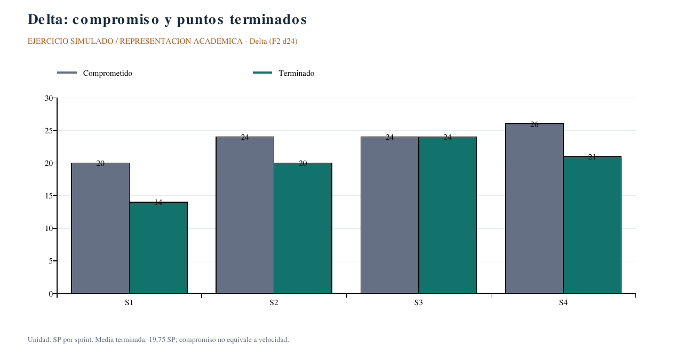
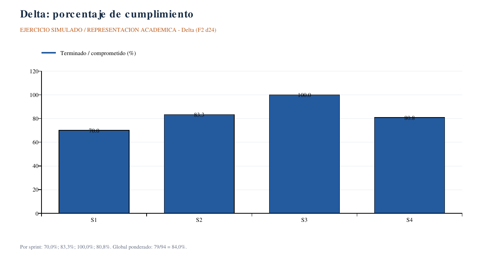
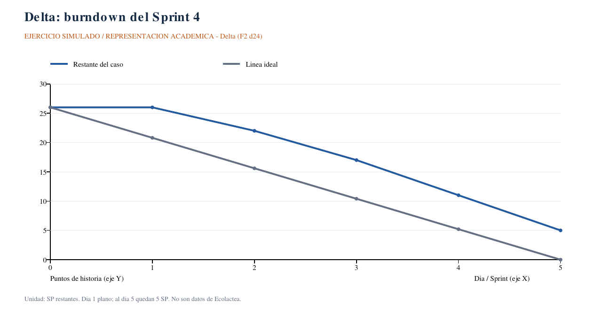
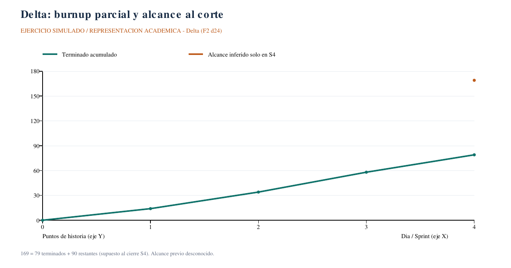

# Caso Delta — indicadores y retrospectiva académica

**EJERCICIO SIMULADO / REPRESENTACIÓN ACADÉMICA.** Fuente: **F2, U2-S4, diapositiva 24 y notas del presentador**. Los datos pertenecen al caso del docente, **no a Ecolactea Digital**, y no demuestran sprints ejecutados por nuestro equipo. Gráficos en PNG para consulta y SVG para exportación; [datos reproducibles](graficos/datos-metricas.json).

## Datos y preguntas 1–2: velocidad, cumplimiento y burndown

| Sprint Delta | Comprometido (SP) | Terminado (SP) | Cumplimiento |
|---|---:|---:|---:|
| 1 | 20 | 14 | 70,00 % |
| 2 | 24 | 20 | 83,33 % |
| 3 | 24 | 24 | 100,00 % |
| 4 | 26 | 21 | 80,77 % |
| Total | 94 | 79 | **84,04 % ponderado** |

**Velocidad media:** (14+20+24+21)/4 = **19,75 SP/sprint**.
**Cumplimiento global:** 79/94 ×100 = **84,04 %**, aproximadamente 84 % según la referencia docente. No es el promedio simple de los cuatro porcentajes.

[SVG exportable](graficos/delta-velocidad.svg). **Interpretación:** el compromiso supera lo terminado en S1, S2 y S4; S3 llega a lo seleccionado. La media se calcula con terminado, no con compromiso. No se usa para clasificar integrantes.

[SVG exportable](graficos/delta-cumplimiento.svg). **Interpretación:** 100 % en S3 no implica idéntica capacidad futura. El 84,04 % global expresa relación agregado terminado/seleccionado; no es cobertura de pruebas ni porcentaje del producto entero.

| Día hábil S4 | Restante del caso (SP) | Línea ideal (SP) |
|---|---:|---:|
| 0 | 26 | 26 |
| 1 | 26 | 20,8 |
| 2 | 22 | 15,6 |
| 3 | 17 | 10,4 |
| 4 | 11 | 5,2 |
| 5 | 5 | 0 |

**Ideal(día):** 26 − (26/5) × día = 26 − 5,2 × día. En el caso, 26−5=21 SP terminados, coherente con la tabla del Sprint 4.

[SVG exportable](graficos/delta-burndown.svg). **Interpretación:** la curva permanece sobre la ideal y acaba con 5 SP pendientes. La ideal es referencia visual, no obligación de cerrar exactamente 5,2 SP al día.

## Pregunta 3: día 1 plano

El restante se mantiene en 26. Según la interpretación docente, no se cerró trabajo contabilizado como Hecho ese día. Posibles explicaciones: historias grandes, impedimentos, acumulación en revisión o trabajo iniciado sin completar DoD. **Son hipótesis**, no causas demostradas por seis mediciones. Inspeccionar tablero, bloqueos y granularidad antes de concluir.

## Pregunta 4: previsión del backlog restante

Product Backlog restante del caso: **90 SP**.

90 / 19,75 = **4,56 sprints**, redondeados hacia arriba: **aproximadamente 5 sprints semanales**. Supone estimación comparable, alcance restante estable y capacidad semejante; no es fecha de entrega confirmada. Con los extremos observados 14–24 SP/sprint, el intervalo ilustrativo sería 4–7 sprints, sin pretender probabilidad estadística. Esta previsión **no se aplica** a los puntos hipotéticos del backlog de Ecolactea.

## Burnup complementario: límite de información

[SVG exportable](graficos/delta-burnup.svg). **Interpretación:** terminado acumulado 14, 34, 58, 79 SP; el origen cero es referencia del ejercicio. Si los 90 restantes corresponden al cierre de S4, alcance total al corte = 79+90=**169 SP**. Se muestra **solo un punto de alcance en S4**: el enunciado no da su historia anterior, por lo que no se inventa una línea constante. Los 94 SP comprometidos acumulados no equivalen al alcance del producto. Confirmar el momento exacto del dato “90 restantes” si se requiere un burnup histórico completo.

## Pregunta 5: dos acciones Start / Stop / Continue

**Propuesta académica**, no retrospectiva real del equipo Delta ni del proyecto. Responsables de preparar la explicación: roles propuestos del equipo Ecolactea. Fechas de trabajo académico propuestas, no acuerdos históricos.

| Formato | Acción propuesta | Responsable propuesto | Fecha propuesta | Evidencia |
|---|---|---|---|---|
| Start | Dividir las HU de más de 8 SP o demasiado amplias para poder completar DoD dentro de la semana. | Medina Paye Jhosue Daniel | 2026-10-22 | EJERCICIO SIMULADO / REPRESENTACIÓN ACADÉMICA |
| Stop | Evitar seleccionar más trabajo que lo sustentado por capacidad y evidencia de velocidad; discutir el exceso 26 vs media 19,75. | Sait Alfredo Gutierres Velasquez | 2026-10-22 | EJERCICIO SIMULADO / REPRESENTACIÓN ACADÉMICA |

Continue como pregunta de cierre: decidir si mantener el Daily y revisión del flujo; no se registra como tercera acción ya acordada. Aplicar las cinco fases de F2 d20 y revisar acciones en la siguiente práctica real.

## Separación respecto del proyecto

Los indicadores reales disponibles de Ecolactea son [actividad Git y fuentes de pruebas](../scrum/metricas.md). Su velocidad, cumplimiento, burndown/burnup real y tiempos de flujo están **EVIDENCIA PENDIENTE**. Este ejercicio satisface una práctica de análisis, no sustituye la evidencia de gestión real en la herramienta.
