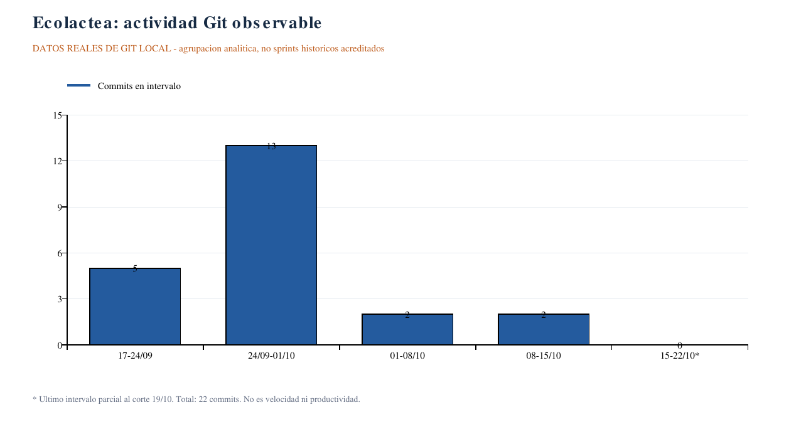
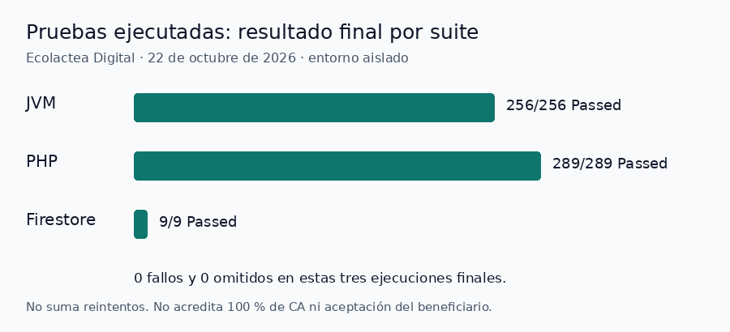

# Métricas: Git observable, Scrum pendiente y Delta académico

**Corte Git:** 2026-10-19. **Actualización documental:** 2026-10-22. [22 commits](evidencias-commits.md) · [índice EV](../evidencias/README.md).

## Datos observables de Ecolactea

| Indicador | Valor | Límite |
|---|---|---|
| Commits / merges | 22 / 2 | Cambios versionados; no historias Done ni aprobaciones. |
| Tres tramos históricos | 18 / 2 / 2 | Segmentación conservada, no Sprint ejecutado. |
| Ventanas analíticas semanales | 5 / 13 / 2 / 2 / 0 parcial | Medianoche jueves→jueves; agenda 18:00 no aplicada retrospectivamente. |
| Fechas con commits | 7 | 17/20/22/23/24-09 y 05/12-10; un día sin commit no implica inactividad. |
| Archivos de pruebas | 48 Kotlin, 32 PHP, 1 Firebase | Fuentes, no cantidad de casos/cobertura/éxito. |
| Log de emulador | Actividad parcial 24-09 | [EV-003](../evidencias/README.md#ev-003), sin resumen/exit status completo. |

[SVG](../academico/graficos/ecolactea-commits-semana.svg). **Interpretación:** segunda ventana concentra 13 commits; el último cero es parcial al corte. No permite inferir calidad, horas o productividad individual. No es burndown ni velocidad.

## Conteos documentales, vista derivada 2026-10-22

61 RF, 17 RNF, 41 HU funcionales (padres/habilitadores sin contar), 86 CA, 82 Gherkin y 91 tareas (19 aportes históricos/72 propuestas). Siete CP manuales: CP-001/002/003/007 Passed; tres Blocked por las condiciones precisas registradas, con comprobaciones automatizadas relacionadas ya ejecutadas. Son artefactos de planificación, no crecimiento del software ni métricas Scrum. El catálogo contiene puntos hipotéticos pendientes de Poker; no se usa su suma como compromiso.

**Estados operativos confirmados:** N/D. Se elimina la antigua distribución propuesta que ponía historias urgentes en Review. No hay Done acreditado, lo cual no permite calcular velocidad cero ni afirmar que nada funciona.

## Registro prospectivo y cálculo

| Métrica | Fórmula futura / definición | Evidencia faltante |
|---|---|---|
| Velocidad | Suma SP consensuados de HU Done en el sprint, sin duplicar padres/arrastres. | Poker, selección y DoD fechados. |
| Cumplimiento | SP Done de selección inicial / SP seleccionados iniciales; separar añadidos/retirados. | Planning y cambios reales. |
| Goal alcanzado | Resultado de Review frente a Goal acordado: sí/no/no determinable con motivo. | Goal real e inspección. |
| Burndown | Restante diario con unidad constante y eventos reales. | Serie diaria; no derivarla de commits. |
| Burnup | Terminado acumulado y alcance total por fecha. | Done y cambios de alcance. |
| Throughput | Tareas o HU Done por periodo; elegir unidad y no mezclar. | Fechas reales de cierre. |
| Cycle time | Inicio In Progress→Done, incluidas espera/revisión/bloqueo. | Transiciones/horas reales. |
| Lead time | Compromiso To Do→Done, convención elegida para el equipo. | Entrada/fin reales; no confundir con inicio. |
| WIP | Tareas iniciadas aún no terminadas, incluidas Review y bloqueos. | Project y export fechados. |
| Calidad | Casos/ejecuciones/resultados por versión y defecto. | Resultados reales del 22-10 disponibles; aceptación completa/revisión del equipo aún pendiente. |

Al adoptar el tablero, guardar fecha/hora, tarea/HU, sprint, selección inicial/cambio, SP acordados, estado/transiciones, restante y enlace al resultado. Mantener N/D si falta dato, no cero. La convención de lead time es local y debe mantenerse consistente.

## Ejercicio Delta, separado del producto

[Resolución y cuatro gráficos](../academico/ejercicio-delta.md): velocidad, cumplimiento, burndown y burnup parcial. **EJERCICIO SIMULADO / REPRESENTACIÓN ACADÉMICA**, con datos del PPT y archivo JSON. Se conservan PNG/SVG originales sin alterar. No sustituye métricas Ecolactea.

Las vistas Git/Delta anteriores se elaboraron sin ejecutar la aplicación. La sección siguiente incorpora pruebas reales ejecutadas el 22-10.

## Métrica técnica real — corte 2026-10-22

[SVG](../academico/graficos/pruebas-reales-2026-10-22.svg) · [Datos canónicos y tests](../pruebas/ejecuciones/resultados-2026-10-22.json) · [Intentos y fallos conservados](../pruebas/ejecuciones/resultados-2026-10-22.md).

**Interpretación:** última ejecución: JVM 256/256, PHP 289/289, Firestore 9/9, cero fallos y omitidos. Se corrigió el montaje temporal y tres tests PHP desactualizados; la regresión final pasó. Los tamaños de suites reflejan selecciones diferentes, no permiten comparar calidad de tecnologías/personas. No se suman 32 tests de regresión ni reruns como casos distintos; build web/APK y CP-001/002/003/007 se reportan aparte. Estos resultados **no son cobertura de los 86 CA, velocidad Scrum, compatibilidad Android/iOS ni aceptación del beneficiario**.

Reproducir la figura desde su JSON: `python3 docs/herramientas/generar_grafico_pruebas.py` (Pillow para PNG, sin dependencias nuevas de la aplicación). El SVG lleva descripción accesible; los cinco gráficos anteriores y sus datos permanecen intactos. No se generan series diarias Scrum sin movimientos/DoD reales.

**Android complementario:** EXE-21/22/25/26 Passed para arranque, login offline, persistencia/reapertura y respuesta perdida/reintento. Se detectó/corrigió ANR de inicio (BUG-002). No se añaden esos pasos o reintentos al conteo de suites de la figura ni a SP/velocidad. Son cuatro CP completos Passed en total, tres aceptaciones completas Blocked por contrato/oráculo; hardware físico/iOS no acreditados.
