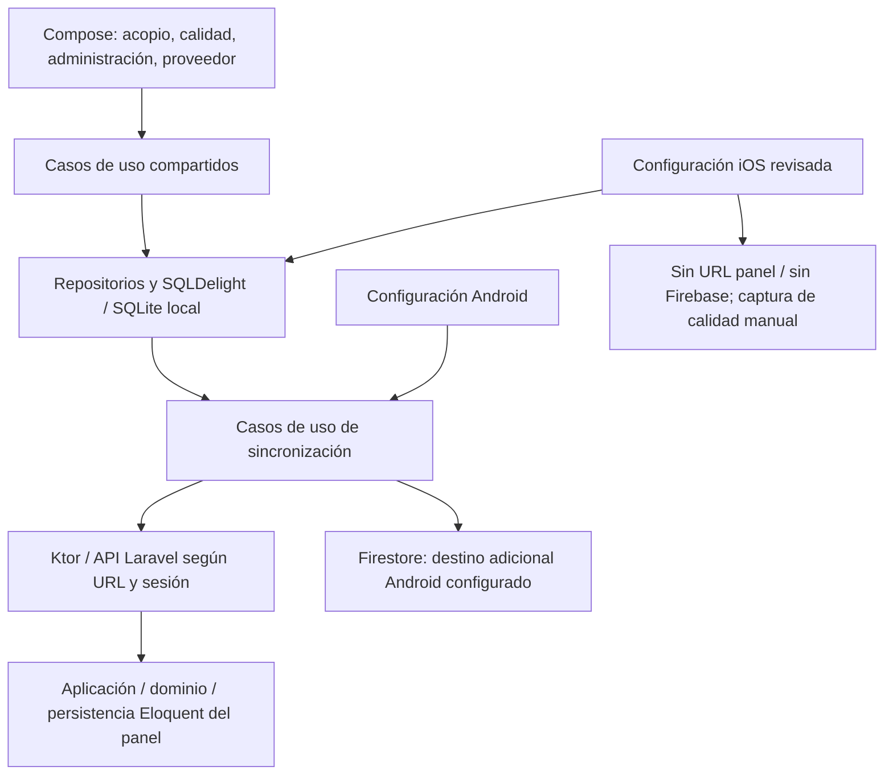

# Arquitectura, datos y sincronización

[Índice](../README.md) · [Trazabilidad](../scrum/trazabilidad.md) · [Validación](../academico/entregables-y-validacion.md)

## Base de lectura y nivel de avance

Se inspeccionó el árbol del commit [05743b9](https://github.com/SaitAlfre/APP-MOVIL/commit/05743b97f2e5835250e223eabc09f9924b7524bb) y cambios relevantes del periodo. La inspección inicial del 21-10 fue estática. El 22-10 sí se levantó un backend aislado, se compilaron web/APK preview y se ejecutaron suites completas; resultados al final de este documento. La aceptación integral de negocio/campo continúa pendiente.

Es una aplicación de complejidad estimada media–alta para cuatro estudiantes: combina clientes móviles, persistencia local, permisos, múltiples destinos y estados distribuidos. La estimación es cualitativa; no hay un porcentaje de avance fiable sin criterios y pruebas acordados.

## Tecnologías declaradas o bloqueadas

| Área | Evidencia en archivos | Límite de la afirmación |
|---|---|---|
| Kotlin Multiplatform / Compose | Kotlin 2.4.10 y Compose 1.11.1 en [libs.versions.toml](../../gradle/libs.versions.toml). | Versiones declaradas; JVM/APK localPreview compilados y UI Android 16 emulada comprobada; no hardware físico ni iOS. |
| Datos y capas compartidas | SQLDelight 2.2.1, coroutines, serialización y Koin 4.2.2; [build.gradle.kts](../../shared/build.gradle.kts). | Contratos y DI presentes; configuración por plataforma distinta. |
| Cliente API | Ktor 3.4.0; motores OkHttp Android y Darwin iOS en Gradle. | Que una dependencia exista no implica destino configurado. |
| OCR | ML Kit 16.0.1 en Android; parser compartido. | No se identificó OCR iOS activo. |
| Backend | PHP ^8.3 requerido en [composer.json](../../web/composer.json); Laravel v13.32.0 y PHPUnit 12.5.35 en [composer.lock](../../web/composer.lock). | La guía web menciona PHP 8.4; aquí se ejecutó runtime temporal PHP 8.3.6 (compatible con composer.json), no se probó 8.4. |
| Panel | Blade, Vite y recursos JS/CSS definidos en [package.json](../../web/package.json). | Build Vite Passed el 22-10 en copia aislada. |
| Base del panel | SQLite por defecto y configuración PostgreSQL en [database.php](../../web/config/database.php). | El motor y datos del entorno publicado no se confirmaron. |
| Destino adicional Android | Firebase Auth/Firestore y reglas versionadas. | Log histórico parcial conservado; el 22-10 reglas 9/9 Passed en emulador demo, no disponibilidad de Firebase desplegado. |

## Capas y entradas de plataforma

El diagrama resume dependencias observadas y no certifica ejecución. La UI no debe confundir persistencia local con confirmación de cada destino.

| Plataforma | Entrada/configuración | Comportamiento identificado |
|---|---|---|
| Android | [EcolectaApp.kt](../../androidApp/src/main/kotlin/pe/ecolecta/EcolectaApp.kt) y [build.gradle.kts](../../androidApp/build.gradle.kts) | URL del panel configurable y valor por defecto Heroku. LOCAL_PREVIEW deshabilita Firebase, pero el panel sigue dependiendo de SERVIDOR_URL; no es automáticamente una app sin red. |
| iOS | [KoinIOS.kt](../../shared/src/iosMain/kotlin/pe/ecolecta/di/KoinIOS.kt) | URL del panel vacía y repositorios Firebase pendientes/no configurados. No se declara sincronización remota disponible por compartir código Ktor. |
| Común | [Koin.kt](../../shared/src/commonMain/kotlin/pe/ecolecta/di/Koin.kt) | Casos de uso/repositorios por inyección; servidor vacío elige implementación no configurada. |

## Módulos y referencias

| Módulo | Referencia técnica | Historias |
|---|---|---|
| Acceso local/remoto | [IniciarSesionUseCase.kt](../../shared/src/commonMain/kotlin/pe/ecolecta/domain/usecase/auth/IniciarSesionUseCase.kt) | [HU-01](../scrum/product-backlog.md#hu-01), [HU-13](../scrum/product-backlog.md#hu-13) |
| Productores y catálogo | [SqlDelightProveedorRepository.kt](../../shared/src/commonMain/kotlin/pe/ecolecta/data/repository/SqlDelightProveedorRepository.kt) | [HU-02](../scrum/product-backlog.md#hu-02) |
| Acopio y jornada | [RegistrarEntregaUseCase.kt](../../shared/src/commonMain/kotlin/pe/ecolecta/domain/usecase/entrega/RegistrarEntregaUseCase.kt) | [HU-03](../scrum/product-backlog.md#hu-03) |
| Calidad móvil/web | [SqlDelightControlCalidadRepository.kt](../../shared/src/commonMain/kotlin/pe/ecolecta/data/repository/SqlDelightControlCalidadRepository.kt); [GuardarAnalisisCalidadUseCase.php](../../web/app/Application/Calidad/GuardarAnalisisCalidadUseCase.php) | [HU-05](../scrum/product-backlog.md#hu-05), [HU-06](../scrum/product-backlog.md#hu-06) |
| Reportes/liquidaciones | [AdminReportesViewModel.kt](../../shared/src/commonMain/kotlin/pe/ecolecta/presentation/admin/reportes/AdminReportesViewModel.kt); [ReporteController.php](../../web/app/Http/Controllers/Admin/ReporteController.php) | [HU-07](../scrum/product-backlog.md#hu-07) |
| Rutas/mapas web | [MapaRutaController.php](../../web/app/Http/Controllers/Admin/MapaRutaController.php); [mapa-rutas.js](../../web/resources/js/mapa-rutas.js) | [HU-08](../scrum/product-backlog.md#hu-08) |
| Importar/exportar datos | [SqlDelightDatosServidorRepository.kt](../../shared/src/commonMain/kotlin/pe/ecolecta/data/repository/SqlDelightDatosServidorRepository.kt); [ExportarDatosMovilQuery.php](../../web/app/Application/Movil/ExportarDatosMovilQuery.php) | [HU-09](../scrum/product-backlog.md#hu-09) |
| Cambios móvil → panel | [SqlDelightCambiosLocalesRepository.kt](../../shared/src/commonMain/kotlin/pe/ecolecta/data/repository/SqlDelightCambiosLocalesRepository.kt); [AplicarCambioMovilUseCase.php](../../web/app/Application/Movil/AplicarCambioMovilUseCase.php) | [HU-10](../scrum/product-backlog.md#hu-10) |
| Portal y avisos | [PortalProveedorViewModel.kt](../../shared/src/commonMain/kotlin/pe/ecolecta/presentation/proveedor/PortalProveedorViewModel.kt); [AdminAlertasViewModel.kt](../../shared/src/commonMain/kotlin/pe/ecolecta/presentation/admin/alertas/AdminAlertasViewModel.kt) | [HU-11](../scrum/product-backlog.md#hu-11), [HU-12](../scrum/product-backlog.md#hu-12) |

## Datos locales y correspondencia con servidor

| Fuente SQLDelight | Propósito y relaciones identificadas |
|---|---|
| [proveedor.sq](../../shared/src/commonMain/sqldelight/pe/ecolecta/db/proveedor.sq) / [jornada.sq](../../shared/src/commonMain/sqldelight/pe/ecolecta/db/jornada.sq) | Catálogo y contexto de operación; identificadores locales y relaciones con acopio. |
| [entrega.sq](../../shared/src/commonMain/sqldelight/pe/ecolecta/db/entrega.sq) | Datos de entrega, relaciones de jornada/productor/autor y estado de sincronización. |
| [controlCalidad.sq](../../shared/src/commonMain/sqldelight/pe/ecolecta/db/controlCalidad.sq) | Parámetros, contexto y referencias de análisis; código de muestra único según esquema. |
| [cambioPendiente.sq](../../shared/src/commonMain/sqldelight/pe/ecolecta/db/cambioPendiente.sq) | Cola genérica por entidad/local_id con estado, error e intentos; no es el mismo recorrido de entregas. |
| [outbox.sq](../../shared/src/commonMain/sqldelight/pe/ecolecta/db/outbox.sq) | Tabla de cola preexistente. Su presencia o comentario de fase no demuestra qué motor la consume hoy. |
| [servidorMapa.sq](../../shared/src/commonMain/sqldelight/pe/ecolecta/db/servidorMapa.sq) | Correspondencias local-servidor que permiten importar/exportar entidades. |
| [tokenServidor.sq](../../shared/src/commonMain/sqldelight/pe/ecolecta/db/tokenServidor.sq) | Sesión remota por usuario local, access/refresh y expiración. No se comprobó cifrado del almacenamiento del dispositivo. |
| [portalProveedor.sq](../../shared/src/commonMain/sqldelight/pe/ecolecta/db/portalProveedor.sq) / [comunicado.sq](../../shared/src/commonMain/sqldelight/pe/ecolecta/db/comunicado.sq) | Datos del portal y avisos persistentes. |

Las migraciones SQLDelight están versionadas. En el panel hay modelos Eloquent y migraciones para entidades móviles, análisis y tokens. El 22-10 se ejecutaron migraciones solo en SQLite temporal nueva para la integración; ninguna migración o comprobación sobre datos productivos. Las relaciones descritas son el modelo observado, no un inventario completo de todas las restricciones de ambos motores.

## Recorrido offline-first identificado

1. El acceso local usa cuenta previamente conocida; una cuenta no conocida o PIN cambiado puede necesitar validación remota. No se promete primera autenticación arbitraria sin red.
2. RegistrarEntregaUseCase valida y guarda entrega/auditoría mediante repositorios sin esperar internet, con ID propio.
3. SincronizarRegistrosAcopioUseCase intenta enviar entregas a destinos configurados; usa cuenta remitente, reintentos y exclusión mutua. El panel es fuente oficial según código y Firestore una copia adicional para proveedor cuando se configura.
4. Las respuestas diferencian enviado, sin conexión, sin enlazar, parcial y fallido. El código pretende marcar sincronizado solo al confirmar destinos y conservar pendientes ante falta de respuesta; los conflictos se reservan a administración.
5. EnviarCambiosServidorUseCase recorre otra cola para entidades generales. Un cuerpo nulo puede completar un cambio sin transmitirlo: no equivale a aceptación remota de toda solicitud local.
6. La descarga desde el panel se importa a tablas y correspondencias locales; alcance por perfil y resolución de conflictos requieren validación.

Esto describe intención y controles de código, no resultados comprobados de red/dispositivo. Los detalles están en [SincronizarRegistrosAcopioUseCase.kt](../../shared/src/commonMain/kotlin/pe/ecolecta/domain/usecase/sync/SincronizarRegistrosAcopioUseCase.kt) y [EnviarCambiosServidorUseCase.kt](../../shared/src/commonMain/kotlin/pe/ecolecta/domain/usecase/sync/EnviarCambiosServidorUseCase.kt).

## API móvil observada

Fuente: [api.php](../../web/routes/api.php); prefijo /api/movil. Esta tabla procede de inspección estática. Las invocaciones reales posteriores corresponden exclusivamente al entorno ficticio y a las [ejecuciones del 22-10](../pruebas/ejecuciones/resultados-2026-10-22.md).

| Método y ruta | Uso | Control observado en rutas |
|---|---|---|
| POST /api/movil/sesion | Inicio de sesión y emisión de credenciales. | Throttle movil-sesion; validación en controlador. |
| POST /api/movil/sesion/refresh | Renovación mediante refresh token. | Throttle movil-refresh; lógica de renovación. |
| DELETE /api/movil/sesion | Cierre/revocación. | Throttle movil-refresh; tratamiento de credenciales en controlador. |
| GET /api/movil/datos | Descargar datos autorizados. | movil.token y throttle movil-sync. |
| PUT /api/movil/cambios/{entidad} | Aplicar cambio de entidad admitida. | Token, lista de entidades permitidas y reglas por rol. |
| PUT /api/movil/entregas/{uuid} | Sincronizar entrega idempotente. | Roles acopiador/admin y throttle movil-sync. |
| GET /api/movil/proveedor/liquidaciones | Liquidaciones del proveedor. | movil.token:proveedor. |

El cliente [ServidorWebRepositoryKtor.kt](../../shared/src/commonMain/kotlin/pe/ecolecta/data/remote/ServidorWebRepositoryKtor.kt) contiene requests, respuesta de sesión/refresh, liquidaciones y manejo de errores. [TokenMovil.php](../../web/app/Infrastructure/Persistence/Eloquent/TokenMovil.php) almacena hashes en servidor y lógica de rotación/reutilización/revocación. La seguridad completa necesita revisar además transporte, permisos y almacenamiento local con pruebas reales.

## Discrepancias y riesgos

| Hallazgo | Consecuencia documental / verificación pendiente |
|---|---|
| [Nota del portal del proveedor](portal-proveedor-movil.md) registraba ausencia de APIs en una versión anterior; ahora distingue ese antecedente del alcance posterior en código. | Conciliar por versión; no repetir como ausencia total ni declarar integración completa. |
| El payload de SOLICITUD se limita a RECLAMO y no transmite la foto en el bloque inspeccionado. | Traslado/foto y retorno de resolución no se dan por terminados; revisar estados locales vs recepción. |
| iOS deja destinos remotos sin configurar y mantiene captura manual. | Limitar afirmaciones de paridad; marcar integración remota iOS pendiente. |
| Mapas web, ruta demo y retiro del seguimiento GPS en un commit. | No prometer GPS activo, mapa offline o recorrido de campo validado. |
| Alertas/comunicados presentes; RF-NOT-04 documenta necesidad de eventos/asistencia, pero módulo de reuniones/push no identificado en la inspección. | Delimitar HU-15 y canal de avisos sin confundir dependencias de framework con función del producto. |
| Configuración Heroku y Procfile presentes. | Preparación de despliegue no acredita servicio vivo ni CI/CD. No se identificó workflow GitHub Actions versionado. |

## Calidad identificada y verificación pendiente

Se encontraron 48 archivos Kotlin Test.kt, 32 PHP Test.php y un archivo de reglas Firebase. Ejemplos rastreables: [LoginOfflineUseCaseTest.kt](../../shared/src/commonTest/kotlin/pe/ecolecta/domain/usecase/LoginOfflineUseCaseTest.kt), [IntegracionPanelWebTest.kt](../../shared/src/androidHostTest/kotlin/pe/ecolecta/data/IntegracionPanelWebTest.kt), [RefreshSesionPanelWebTest.kt](../../shared/src/androidHostTest/kotlin/pe/ecolecta/data/RefreshSesionPanelWebTest.kt), [RefreshTokenMovilTest.php](../../web/tests/Feature/RefreshTokenMovilTest.php) y [registros-acopio.rules.test.mjs](../../firebase-tests/registros-acopio.rules.test.mjs).

Existe además [firestore-debug.log](../../firebase-tests/firestore-debug.log): actividad del emulador el 24-09, sin resumen de suite/exit status. El test usa assertFails para denegaciones esperadas; advertencias de permisos no prueban por sí mismas fallo de suite. [EV-003](../evidencias/README.md#ev-003). No se infiere cobertura o éxito. Ese fue el límite de la inspección inicial. Las ejecuciones del 22-10 añadieron resultados por versión y pruebas offline/reconexión concretas, sin acreditar todos los roles, plataformas ni validación con el beneficiario. El [plan académico](../academico/entregables-y-validacion.md) indica qué resultados deben registrarse en una sesión real posterior.

## Ampliación documental según la fuente empresarial — 20-10-2026

| Necesidad documentada | Archivo actual identificado | Historia y límite |
|---|---|---|
| Producción: lotes y rendimiento | [CrearLoteProduccionUseCase.php](../../web/app/Application/Produccion/CrearLoteProduccionUseCase.php), [FinalizarLoteProduccionUseCase.php](../../web/app/Application/Produccion/FinalizarLoteProduccionUseCase.php) | HU-16; presencia de código, no funcionamiento ni alcance completo de RF-PROD verificados. |
| Ventas | [VentaController.php](../../web/app/Http/Controllers/Admin/VentaController.php) | HU-17; precio, stock, clientes y resultados EVIDENCIA PENDIENTE. |

F4 aporta necesidades de producción/ventas/eventos y no se le atribuyen Angular/Ionic. Es F6, el informe de adaptación Excel, el que menciona Angular 22/Ionic/Capacitor; no coincide con la versión Kotlin Multiplatform/Laravel. RF→CA y límites están en [requisitos](../requisitos/rf-fuente-y-cobertura.md).

## Referencias adicionales y discrepancias de negocio — 2026-10-21

| Función observada | Fuente concreta | Límite / historia |
|---|---|---|
| Registro de varios productores por lote | [RegistrarLoteUseCase.kt](../../shared/src/commonMain/kotlin/pe/ecolecta/domain/usecase/entrega/RegistrarLoteUseCase.kt) | HU-03-B; transacción en código no demuestra tiempo de atención ni resultado en dispositivo. |
| Autorización de traslado | [AutorizarTrasladoUseCase.kt](../../shared/src/commonMain/kotlin/pe/ecolecta/domain/usecase/traslado/AutorizarTrasladoUseCase.kt) | HU-18; autorización local no demuestra envío/recepción de SOLICITUD de traslado. |
| Recepción y diferencia campo/planta | [RegistrarLlegadaUseCase.php](../../web/app/Application/Recepcion/RegistrarLlegadaUseCase.php), [ObtenerDashboardOperativoUseCase.php](../../web/app/Application/Reportes/ObtenerDashboardOperativoUseCase.php) | HU-23, RF-REP-02 manual Fase 1. Confirmar signo/regla de merma y medición; caudalímetro es Fase 2. |
| Producción | [CrearLoteProduccionUseCase.php](../../web/app/Application/Produccion/CrearLoteProduccionUseCase.php) | Cambios reales en 1fb3dab y 6104b68; HU-16-A/B/C, sin incremento validado. |
| Venta/stock | [VentaController.php](../../web/app/Http/Controllers/Admin/VentaController.php) | Cambio 6104b68; cantidades/precio, transacción y descuento de stock. Tipos de cliente diferentes de F4; tarifa automática y mínimo no acreditados. |
| Sanciones/liquidación | [SancionController.php](../../web/app/Http/Controllers/Admin/SancionController.php), [GenerarLiquidacionUseCase.php](../../web/app/Application/Liquidaciones/GenerarLiquidacionUseCase.php) | OBS-01: 30.50/15 y aprobación de propuestas; suma descuentos aprobados. No acredita reglas F4 por porcentaje/reincidencia/semana o capacitación sin descuento. |

**OBS-02:** el cuerpo nulo **o usuario vacío** de EnviarCambiosServidorUseCase se completa localmente sin transmitir; no equiparar “cola completada” con “recibido por el panel”. El flujo dedicado de entregas es distinto de la cola general. Estas son observaciones estáticas, no fallos reproducidos; [seguimiento](../auditoria-documentacion.md#observaciones-tecnicas-abiertas).

## Roles de negocio y plataformas

| Fuente | Roles/perfiles observados | Interpretación |
|---|---|---|
| F4 RF-USU-02 | 7 roles empresariales, incluidos asistente, producción y despacho. | Requisito pendiente de homologación de permisos. |
| [Rol.kt](../../shared/src/commonMain/kotlin/pe/ecolecta/domain/model/Rol.kt) | ADMIN, ACOPIADOR, CALIDAD, PROVEEDOR. | 4 perfiles móviles, no los cuatro integrantes del equipo. |
| [Rol.php](../../web/app/Domain/Usuarios/Rol.php) | 10 roles web: acopiador, calidad, admin, asistente, produccion, despacho, proveedor, recepcion, liquidaciones, consulta. | Enumeración no acredita permisos efectivos; probar cada operación/ámbito. |

## Decisiones técnicas y cómo mantenerlas

Fuente principal de decisiones técnicas: esta sección. No se atribuyen acuerdos históricos a los autores del código.

| ID | Situación / decisión propuesta | Estado y validación |
|---|---|---|
| DT-01 | Distinguir UUID/confirmación del destino oficial de copia adicional y de cola general. Mantener estados explícitos para exclusiones/errores. | Propuesta documental; contrato y política de confirmación PENDIENTES DE VALIDACIÓN. |
| DT-02 | Homologar reglas F4 de sanciones, costos, precios y roles antes de aceptarlas como implementadas. | PO con beneficiario, EP-02/12; no se cambió software. |
| DT-03 | Declarar Android e iOS por capacidades verificadas, no por compartir dependencias. | Alcance documentado; prueba de compatibilidad EP-08. |

Para una decisión nueva: ID, fecha real, contexto, opciones, responsable que decide, decisión/estado, consecuencias, RF/HU y evidencia. Un cambio de API actualiza tabla de rutas/credenciales/errores; uno de datos actualiza tablas/migraciones y compatibilidad local; uno de sincronización actualiza identidad/estados/destinos/reintentos; uno de reglas actualiza F4 homologado y CA. [Procedimiento de mantenimiento](../guia-mantenimiento-documentacion.md).

## Comprobación técnica real — 2026-10-22

[Resultados por intento y test](../pruebas/ejecuciones/resultados-2026-10-22.md): JVM 256/256, PHP 289/289, Firestore 9/9, builds web/preview y acceso web. IntegracionPanelWebTest ejecutó Ktor/SQLite reales con backend local: pendiente sin sesión, envío, mismo UUID, corrección/anulación, firma de admin, servidor inalcanzable, descarga idempotente y lectura de liquidación fixture; RefreshSesionPanelWebTest completó cuatro casos. Android emulado se comprobó después en EXE-21/25/26; no demuestra hardware físico, iOS ni homologación de OBS-01/02/04. Ninguna regla de negocio se cambió para hacer pasar las pruebas.

Tres tests PHP se ajustaron al menú/rutas de 52dab50; dos archivos Android corrigen el arranque por ANR. Esquema, contratos y reglas de negocio permanecieron intactos; sus hashes, el parche y regresión constan en JSON. Esta evidencia reemplaza el límite anterior de inspección exclusivamente estática para los casos efectivamente ejecutados, sin certificar todo el producto.

### DT-04 — arranque Android sin bloquear main, 2026-10-22

Decisión técnica ejecutada por agente autorizado a partir de ANR reproducido: preparar Koin/DatabaseSeeder en Dispatchers.Default desde Application; MainActivity observa EstadoInicio y construye App solo en LISTO, con preparación/error visibles. Previene consultas prematuras a Koin/DB. Algoritmo PBKDF2, 20 000 iteraciones, sal/formato, transacciones y reglas permanecen sin cambios. No es una decisión atribuida a una reunión estudiantil. Build/regresión y prueba de acceso/persistencia/sync en EXE-20…26; revisión por compañero pendiente.

**Estado observado con respuesta perdida:** el proxy guardó U1 y perdió 201; su bloqueo posterior 503 dejó ERROR en el cliente, sin confirmación falsa. Con respuesta 200 válida pasó a SYNCED; backend mantuvo 20 L/una fila. No se deduce política completa de errores, conflictos ni paridad Firebase/iOS.

## Corrección de cola general y soporte de QA

BUG-003 conserva cambios con cuerpo válido y autor vacío en PENDING con motivo; solo un autor válido posterior puede enviarlos. Los cuerpos nulos/no aplicables aún se retiran sin sumar enviados, con alcance residual OBS-02. [Defecto y regresiones](../pruebas/defectos/README.md#bug-003--descarte-local-de-un-cambio-válido-sin-autor).

La instrumentación utiliza el APK localPreview en un emulador nuevo; ML Kit reconoce imágenes sintéticas antes de pasar texto al parser compartido. Registro/reapertura se ejecutan mediante los mismos casos de uso y repositorios SqlDelight de la aplicación. No se añade un Activity de pruebas al producto ni se cambia el modelo de negocio. Los resultados y límites están en [cobertura](../pruebas/cobertura-y-cierre.md).
